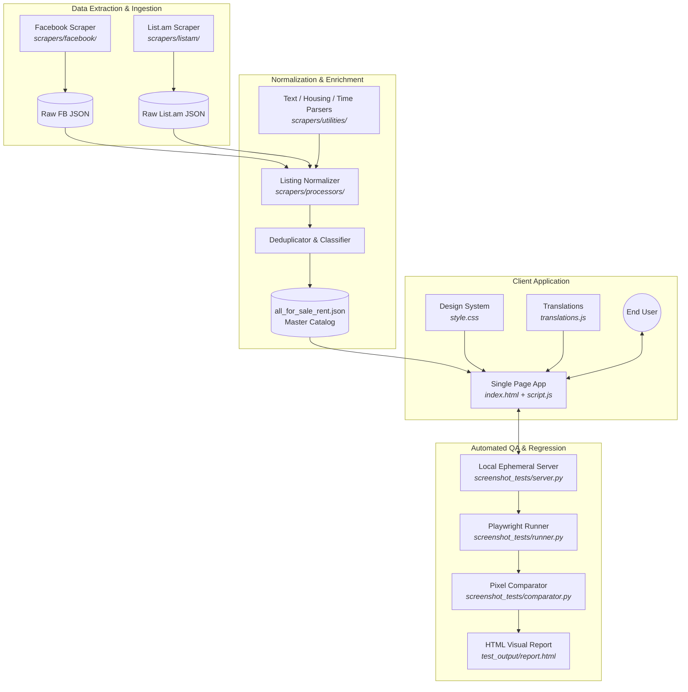

# 🏗️ System Architecture & Data Flow

This document details the architecture, design principles, component contracts, and end-to-end data lifecycle of the **Armenia Real Estate Hub**.

---

## 🌐 High-Level Architecture Overview

The system is organized as a decoupled, static-first web architecture:

1. **Ingestion & Scraper Engine (Python)**: Extracts raw real estate listings from heterogeneous Armenian sources (Facebook public groups, List.am).
2. **Data Normalization & Enrichment (Python)**: Cleanses text, extracts phone numbers, detects pricing currencies (USD, AMD), parses square meters, classifies property categories (Apartment, House, Land), detects zoning (Residential, Agricultural), and deduplicates entries.
3. **Master JSON Catalog**: Outputs atomic, optimized JSON files consumed directly by the static frontend without requiring a live backend database.
4. **Client-Side Single Page Application (Vanilla HTML/CSS/JS)**: Fast, accessible, client-side filtering, sorting, multi-language localization (EN/HY), and infinite scroll pagination.
5. **Quality Assurance & Visual Regression (Playwright / Python)**: Automated screenshot verification across desktop, tablet, and mobile breakpoints to prevent visual regressions.

---

## 🔄 End-to-End Data Lifecycle

### 1. Ingestion Stage
The scrapers derive from [`BaseScraper`](file:///d:/Projects/kittyalshimeowik.github.io/scrapers/base_scraper.py) to provide standard execution, logging, and error handling.
- **List.am**: Gathers structured classifieds, extracts listing IDs, descriptions, pricing, and locations.
- **Facebook**: Gathers post bodies, timestamps, author details, and permalinks from monitored real estate groups.

### 2. Normalization Stage
Located in [`scrapers/utilities/`](file:///d:/Projects/kittyalshimeowik.github.io/scrapers/utilities/):
- **Pricing**: Parses currency signs (`$`, `֏`, `AMD`, `USD`), handles conversion rates (default 364.18 AMD / USD).
- **Locations**: Matches Yerevan districts (*Kentron, Arabkir, Avan, Davtashen, etc.*) and surrounding regional towns (*Abovyan, Ashtarak, Tsaghkadzor, Dilijan, etc.*) across English, Armenian, and Russian spelling variants.
- **Zoning**: Distinguishes residential/homestead land from agricultural/farming land using contextual Armenian regex parsing with park-exclusion guards.
- **Deduplication**: Identifies cross-posted listings using canonical ID hashes, phone matching, and text similarity.

### 3. Master JSON Storage
The final cleaned data is compiled into:
- `scrapers/processors/master_listings_json/all_for_sale_rent.json`

This file is served statically and cached by browsers via HTTP caching headers.

### 4. Client Presentation Layer
When the user visits `index.html`:
- A lightweight skeleton loading state appears immediately to minimize Cumulative Layout Shift (CLS).
- Data is fetched asynchronously via `fetch()`.
- Initial batch of 24 items is rendered with high-performance DocumentFragment manipulation.
- Subsequent items are lazy-loaded via `IntersectionObserver` infinite scrolling or the manual "Load More" button.
- User filter adjustments (checkboxes, keyword searches, mode toggles) filter the in-memory array in under 5ms without server roundtrips.

---

## 📊 Master Listing Data Schema

Each listing object in `all_for_sale_rent.json` adheres to this standard schema:

| Field | Type | Description | Example |
| :--- | :--- | :--- | :--- |
| `canonical_id` | `string` | Unique identifier across platforms | `"fb_10229482910"` |
| `source` | `string` | Origin platform | `"Facebook"` or `"List.am"` |
| `url` | `string` | Canonical link to listing | `"https://facebook.com/groups/..."` |
| `listing_type` | `string` | Transaction type | `"Sale"` or `"Rent"` |
| `property_category` | `string` | Type of real estate | `"Apartment"`, `"House"`, `"Land"` |
| `zoning` | `string[]` | Purpose / Zoning classification | `["Housing"]` or `["Agricultural"]` |
| `locations` | `string[]` | Recognized Armenian localities | `["Kentron / Center", "Arabkir"]` |
| `prices` | `object[]` | Structured price records | `[{"amount_usd": 49000, "amount_amd": 17844820}]` |
| `sizes_sqm` | `number[]` | Area in square meters | `[85.0]` |
| `rooms` | `string[]` | Number of bedrooms/rooms | `["3"]` |
| `phone_numbers` | `string[]` | Cleaned contact numbers | `["+374 94 880 550"]` |
| `creation_timestamp` | `number` | Unix timestamp of post | `1712839200` |
| `full_text` | `string` | Original listing body | `"Վաճառվում է 3 սենյականոց..."` |
| `full_text_en` | `string` | English translation of listing body | `"3-room apartment for sale in..."` |
